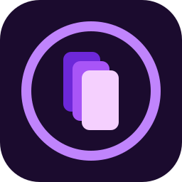
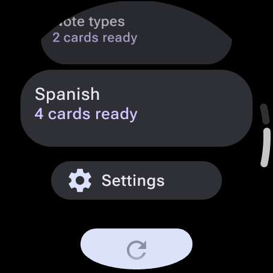
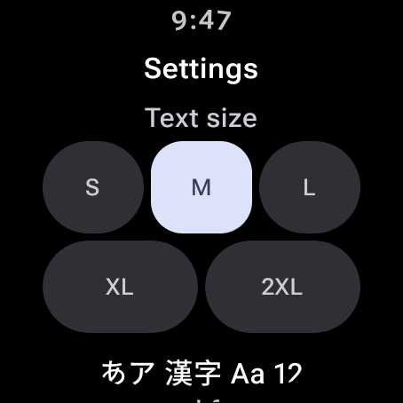
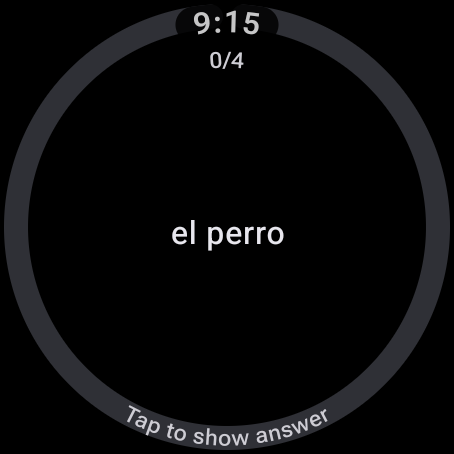
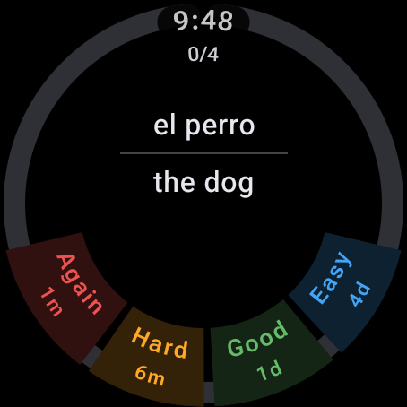
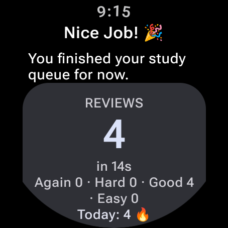
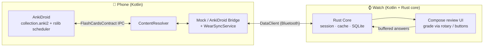

<p align="center">
  
</p>

# Wear for AnkiDroid

[](https://github.com/nikosavola/AnkiDroid-WearOS/actions/workflows/ci.yml)
[](https://github.com/nikosavola/AnkiDroid-WearOS/actions/workflows/codeql.yml)
[](LICENSE)

An offline-first Wear OS smartwatch companion for
[AnkiDroid](https://github.com/ankidroid/Anki-Android). See what is due, read the card, reveal the
answer and grade it from your wrist. The companion phone app writes each grade back into your real
AnkiDroid collection, so AnkiDroid keeps owning the schedule.

The project is pre-release: the review loop works end to end, but there is no published app release
yet.

Anki® is a registered trademark of Ankitects Pty Ltd. AnkiDroid is a trademark of the AnkiDroid Open Source Team. This app is an unofficial third-party companion and is not affiliated with or endorsed by Ankitects or the AnkiDroid team.

| Decks | Settings | Question | Answer and grades | Session end |
| --- | --- | --- | --- | --- |
|  |  |  |  |  |

Screenshots are real captures from a Wear OS emulator, regenerated with `just screenshots`.

---

## 1. Requirements

- An Android phone with AnkiDroid 2.24 or newer installed and a collection set up.
- An Android phone with API 26 or newer, running the companion app.
- A Wear OS 3 watch (API 30 or newer) paired with that phone, running the watch app.
- The watch app is not standalone. It needs the phone companion for the first deck sync and for
  write-back.

The phone companion asks for AnkiDroid's `com.ichi2.anki.permission.READ_WRITE_DATABASE` runtime
permission. That is AnkiDroid's public ContentProvider permission, and nothing is read or written
without it.

---

## 2. Architecture Overview

This project uses a unified **Kotlin + Rust (via UniFFI)** hybrid architecture:



- **Core logic in Rust (`core/`):** the review session state machine, the SQLite offline answer
  buffer, JSON serialization, the offline scheduler previews and the HTML
  tag-stripping/sanitizing parser. It is compiled to native libraries (`.so`) with `cargo-ndk` and
  exported to Kotlin via **UniFFI** and **JNA**.
- **Platform layers in Kotlin (`phone/` and `wear/`):** UI (Jetpack Compose), background
  synchronization (`WearSyncService`), text-to-speech, and system integrations such as the Wear OS
  tile, complication and widget.
- **Communication layer:** Google Play Services `DataClient` syncs card batches and buffered
  reviews over the phone/wear Bluetooth link, and keeps unsent answers on the watch if the phone
  is away.

---

## 3. Key Features

- **Offline-first review buffer:** the watch keeps its own SQLite database. Reviews made while
  disconnected are stored locally and pushed to the phone companion on reconnection.
- **Responsive Wear OS Compose UI:** a circular-safe layout built with Wear OS Compose.
- **Dynamic grading grid:** adapts to 3-button or 4-button templates depending on the card's deck
  configuration, with a scheduled interval preview on each grade.
- **Text-to-speech:** an optional voice review mode reads the front on load and the answer on
  reveal.
- **Native surfaces:** a tile, a watch-face complication and a Wear OS 7 widget show the cards due
  today.
- **Rich card rendering:** cards that need CSS or images are rendered on the phone and cached on
  the watch as bitmaps, because most watches have no WebView. Plain text cards render natively.
- **Mock fallback:** debug builds generate virtual cards when AnkiDroid is not installed, so the
  full review flow is testable on emulators. Release builds need the Force Mock Mode toggle.

---

## 4. Directory Layout

```
├── core/                # Rust shared core: state machine, local buffer, and serializers
├── ankidroid-provider/  # Standalone Kotlin client for AnkiDroid's ContentProvider (LGPL)
├── bindings/            # Auto-generated Kotlin UniFFI binders (gitignored)
├── phone/               # Android companion phone app: ContentProvider client and sync service
└── wear/                # Android Wear OS watch app: Compose UI, tile, complication and widget
```

---

## 5. Building

### Prerequisites

1. **Java JDK 21:** set as the Gradle compiler JVM (`JAVA_HOME`). macOS: `brew install openjdk@21`
   then `JAVA_HOME=/opt/homebrew/opt/openjdk@21`. Linux: `/usr/lib/jvm/java-21-openjdk-amd64`.
   Any JDK 17-26 also works. See [CONTRIBUTING.md](.github/CONTRIBUTING.md) for the full setup.
2. **Android SDK** platform 37.2 and build tools 37.x.
3. **Android NDK** 27.0.12077973, the version pinned by both app modules.
4. **Rust Android targets:**
   ```bash
   rustup target add aarch64-linux-android armv7-linux-androideabi x86_64-linux-android
   cargo install cargo-ndk
   ```

### Compile the Rust core and generate bindings

```bash
JAVA_HOME=<jdk21> ./gradlew generateBindings
```

### Build both apps

```bash
JAVA_HOME=<jdk21> ./gradlew :phone:assembleDebug :wear:assembleDebug
```

Install the two APKs on a paired phone and watch, then launch both once so they can find each other
over the Data Layer. The usual recipes are in the `Justfile`, which sets `ANDROID_HOME` and the
worker cap for you: `just assemble`, `just test`, `just lint`, `just screenshots`.

---

## 6. Testing

```bash
# Rust core unit tests
cargo test --manifest-path core/Cargo.toml

# JVM tests (JUnit, Robolectric, MockK, Compose under Robolectric)
JAVA_HOME=<jdk21> ./gradlew :phone:testDebugUnitTest :wear:testDebugUnitTest

# Formatting, linting and analysis, same checks as CI
uv run prek run --all-files
```

The instrumented tests need a real AnkiDroid install and are not part of CI. They skip themselves
when AnkiDroid is absent. The GMS Data Layer hop, rotary input, tiles, TTS and battery behavior
need a real paired phone and watch, so walk them by hand before a release.

For emulator setup, including the macOS AVD commands and the Linux redroid path, see
[CONTRIBUTING.md](.github/CONTRIBUTING.md).

---

## 7. Privacy

Card text and images travel only between your own phone and watch, over the Wear OS Data Layer
Bluetooth link. Grades are buffered in a local SQLite database on the watch and written back through
AnkiDroid's ContentProvider. The apps collect no analytics, contact no server other than the phone
and watch, and send nothing to the developer.

AnkiDroid itself may sync your collection to AnkiWeb. That is AnkiDroid's behavior, not this
project's, and is configured there.

---

## 8. Published packages

`:ankidroid-provider` is a small Kotlin library for AnkiDroid's flashcard ContentProvider: deck
lists with due counts and options, AnkiDroid's own review queue, card scheduler state, Anki-search
card queries, and a write-back that confirms each answer actually landed. It has no Rust and no
dependencies beyond the Kotlin stdlib. Calls are blocking, so make them off the main thread. Your
app needs AnkiDroid installed and the `com.ichi2.anki.permission.READ_WRITE_DATABASE` runtime grant.

Each `vX.Y.Z` tag publishes `fi.nikosavola:ankidroid-provider:X.Y.Z` to GitHub Packages. Reading
from GitHub Packages needs a classic personal access token with `read:packages`, even for public
packages:

```kotlin
// settings.gradle.kts
dependencyResolutionManagement {
  repositories {
    maven {
      url = uri("https://maven.pkg.github.com/nikosavola/AnkiDroid-WearOS")
      credentials {
        username = System.getenv("GITHUB_ACTOR")
        password = System.getenv("GITHUB_TOKEN")
      }
    }
  }
}

// build.gradle.kts
dependencies { implementation("fi.nikosavola:ankidroid-provider:0.1.0") }
```

The same tags also build on [JitPack](https://jitpack.io) without a token, once the repository is
public: add `maven("https://jitpack.io")` and depend on
`com.github.nikosavola.AnkiDroid-WearOS:ankidroid-provider:v0.1.0`.

The library is LGPL-3.0-or-later (see `ankidroid-provider/COPYING.LESSER`), the same license as
AnkiDroid's own API library, so apps of any license can use it.

---

## 9. Contributing

See [CONTRIBUTING.md](.github/CONTRIBUTING.md) for build, test and emulator setup, and
[CODE_OF_CONDUCT.md](.github/CODE_OF_CONDUCT.md) for community expectations. Found a security
issue? See [SECURITY.md](.github/SECURITY.md) instead of opening a public issue. Release steps,
including the library publish on tags, are in [docs/RELEASING.md](docs/RELEASING.md).

---

## 10. License

AGPL-3.0-or-later, the same license as Anki itself; see [LICENSE](LICENSE). The exception is the
`ankidroid-provider/` library, which is LGPL-3.0-or-later (`ankidroid-provider/COPYING.LESSER`,
which supplements the GPL in `ankidroid-provider/COPYING`). `core/vendor/anki/` holds files from
Anki's `rslib` verbatim (Copyright Ankitects Pty Ltd and contributors, AGPL-3.0-or-later; pinned in
`core/vendor/anki/UPSTREAM.toml`, checked by `scripts/vendor-rslib.sh --check`), and the queue
builder in `core/src/pool.rs` ports logic from it.

The phone app bundles [MathJax](https://www.mathjax.org/) 3.2.2 (Apache-2.0, see
`phone/src/main/assets/mathjax/LICENSE`).

The AnkiDroid and Anki names and logos are not covered by this license. They are used descriptively
to say which app this project talks to, and this project is not affiliated with or endorsed by
either. The launcher icon is original artwork drawn for this project.
