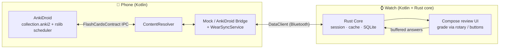

# AnkiDroid WearOS Companion

An offline-first Wear OS smartwatch companion for [AnkiDroid](https://github.com/ankidroid/Anki-Android), designed to let you study and grade flashcards directly from your wrist.

---

## 1. Architecture Overview
This project uses a unified **Kotlin + Rust (via UniFFI)** hybrid architecture:



- **Core Logic in Rust (`core/`):** All platform-agnostic layers—the review session state machine, the SQLite offline answer buffer, JSON serialization, and the high-performance HTML tag-stripping/sanitizing parser—are built in Rust. It is compiled to native libraries (`.so`) using `cargo-ndk` and exported to Kotlin via **UniFFI** and **JNA**.
- **Platform Layers in Kotlin (`phone/` and `wear/`):** Kotlin subprojects handle UI (Jetpack Compose), local background synchronization (`WearSyncService`), Text-to-Speech (TTS), and system integrations (like the Wear OS Tile).
- **Communication Layer:** Uses Google Play Services `DataClient` to reliably sync pending card batches and user reviews back-and-forth over Bluetooth, surviving device disconnections.

---

## 2. Key Features

- **Offline-First Review Buffer:** The watch holds its own SQLite caching database. If you go offline or walk away from your phone, reviews are stored locally, sorted, and automatically pushed back to the companion phone app upon re-connection.
- **Responsive Wear OS Compose UI:** A gorgeous, circular-safe layout built with Wear OS Compose.
- **Dynamic Grading Grid:** Automatically adapts to 3-button or 4-button templates depending on the card's deck configuration, rendering color-coded chips with scheduled interval previews.
- **Text-to-Speech (TTS) Voice Reviews:** Toggling "Voice Reviews" on the dashboard activates system-native vocal readouts that read cards' front text on load and answer text on reveal.
- **System-Native Tiles:** Displays pending cards due today natively inside the smartwatch's quick-swipe carousel using Google's modern `androidx.wear.tiles` and `androidx.wear.protolayout` standards.
- **AnkiDroid Mock Fallback:** To facilitate testing in emulator or headless CLI environments, the phone bridge automatically falls back to generating virtual cards and mocking scheduling operations if the real AnkiDroid app is not installed.

---

## 3. Directory Layout

```
├── core/                # Rust shared core: state machine, local buffer, and serializers
├── bindings/            # Auto-generated Kotlin UniFFI binders (gitignored)
├── phone/               # Android Companion Phone App: ContentProvider client and sync service
└── wear/                # Android Wear OS Watch App: Jetpack Compose UI, Tile Service, and TTS
```

---

## 4. Getting Started & Compilation

### Prerequisites
1. **Java JDK 21:** Set as your active Gradle compiler JVM (`JAVA_HOME`). macOS: `brew install openjdk@21` then `JAVA_HOME=/opt/homebrew/opt/openjdk@21`; Linux: `/usr/lib/jvm/java-21-openjdk-amd64`. Any JDK 17-26 also works. See `CONTRIBUTING.md` for the full macOS emulator setup.
2. **Android NDK (r28+) & SDK:** Correctly installed on your local machine.
3. **Rust Android Targets:** Ensure your Rust toolchain can cross-compile to Android architectures:
   ```bash
   rustup target add aarch64-linux-android x86_64-linux-android
   ```

### Compile Rust & Generate Bindings
To cross-compile all Android native `.so` binaries (`arm64-v8a` and `x86_64`) and generate the Kotlin UniFFI bindings, run:
```bash
JAVA_HOME=<jdk21> ./gradlew generateBindings
```

### Full Kotlin Compilation
To compile both the phone companion and smartwatch projects, run:
```bash
JAVA_HOME=<jdk21> ./gradlew compileDebugKotlin
```

---

## 5. Verification & Testing

### Running Rust Core Tests
We host a complete Rust unit test suite verifying our SQLite buffered schemas, state-machine transitions, and HTML-cleansing layers. Run them locally via:
```bash
cargo test --manifest-path core/Cargo.toml
```

### Local Emulation
You can install both modules onto an Android Phone and a Wear OS circular emulator. The phone companion will automatically pair with the watch's sync listener and detect whether the local `com.ichi2.anki.flashcards` provider is available, falling back to mock cards for testing if needed.

For a lightweight, headless phone environment (no KVM/AVD needed), `CONTRIBUTING.md` documents running Android in Docker via **redroid** — handy for verifying the AnkiDroid write-back path and phone UI on a server or remote VM.
